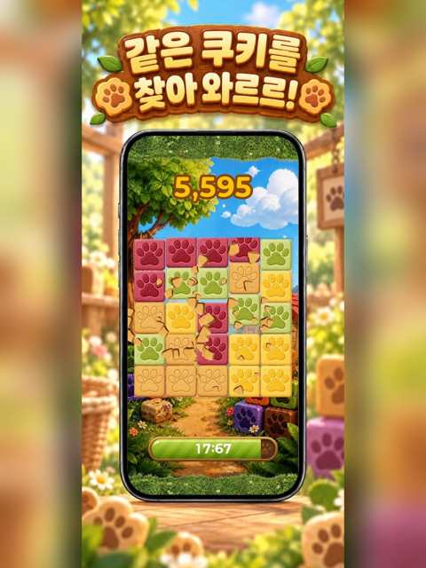
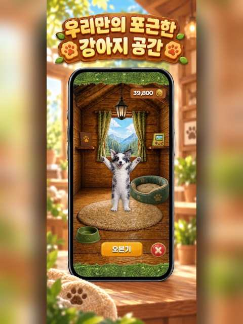
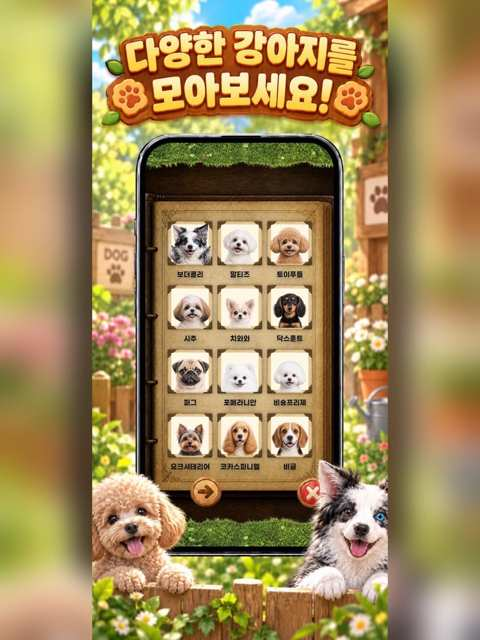

Here is the result of "fetch" for the Page with URL https://app.notion.com/p/3e34e725f312811ba053cbdfbdd67291 as of 2026-09-22T04:13:01.414Z:
<page url="https://app.notion.com/p/3e34e725f312811ba053cbdfbdd67291" icon="🎮">
<ancestor-path></ancestor-path>
<properties>
{"title":"클라이언트 개발자"}
</properties>
<iconMetadata>{"type":"emoji","emoji":"🎮"}</iconMetadata>
<content>
> <b>강우혁 \| Unity Client Developer</b>

> Unity/C# 기반 모바일 클라이언트 개발 · 실서비스 운영 · 성능/메모리 문제 해결 · 팀 리딩 · iOS 개인 게임 출시

<callout icon="🔗" color="blue_bg">
<b>Important Links</b>

- [개발자 포트폴리오 웹](https://devlog1337.github.io/devlog-profile-site/)
- [GitHub 프로필](https://github.com/devlog1337)
- [Unity 공개 코드 포트폴리오](https://github.com/devlog1337/unity-client-portfolio)
- [Howly Dog · App Store](https://apps.apple.com/kr/app/%ED%95%98%EC%9A%B8%EB%A6%AC%EB%8F%84%EA%B7%B8/id6795132117)
- [CatchU · Google Play](https://play.google.com/store/apps/details?id=com.KLP.RZG)
- [CatchU · App Store](https://apps.apple.com/kr/app/id1512653202)
- [CatchU · 공식 사이트](https://catchu.kr/)
</callout>

<columns>
<column ratio="50">
<b>Contact</b>

- 010-3434-7664
- [devlog1337@gmail.com](mailto:devlog1337@gmail.com)
</column>
<column ratio="50">
<b>Links</b>

- [개발자 포트폴리오 웹](https://devlog1337.github.io/devlog-profile-site/)
- [GitHub](https://github.com/devlog1337)
- [Unity 코드 포트폴리오](https://github.com/devlog1337/unity-client-portfolio)
- 희망 직무: Unity / 게임 클라이언트 개발자
</column>
</columns>

---

# Profile

Unity와 C#을 기반으로 모바일 클라이언트를 개발해 온 <b>3년+ 경력의 클라이언트 개발자</b>입니다.

실무에서는 UI/UX 구현, HTTPS API 연동, JSON 데이터 처리, DOTween 기반 모션, 런타임 텍스처 관리, 성능 이슈 분석과 유지보수를 담당했습니다. 클라이언트 파트장으로 코드 리뷰, 업무 분배, 개발 기준 정립, 팀원 온보딩과 교육도 수행했습니다.

개인 프로젝트 <b>Howly Dog</b>에서는 기획부터 Unity 클라이언트, Firebase 연동, iOS 빌드와 App Store 출시까지 직접 진행했습니다. 기능 구현 자체보다 <b>실제 서비스에서 발생한 문제를 분석하고, 원인을 찾아 제품 수준에서 해결하는 개발</b>을 중요하게 생각합니다.

# Key Highlights

- <b>Unity 클라이언트 실무 3년+</b> · 실서비스 기능 개발 및 운영/유지보수
- <b>Google Play 10만+ 다운로드 서비스 CatchU 개발 경험</b> · [Google Play](https://play.google.com/store/apps/details?id=com.KLP.RZG) · [서비스](https://catchu.kr/)
- <b>클라이언트 파트장 경험</b> · 실무 1\~2년차부터 파트장 역할 수행, 본인 제외 최대 4명 업무 진행, 코드 리뷰, 결과물 검수
- <b>Unity Profiler 기반 문제 해결</b> · 동적 텍스처 메모리 누적 원인을 분석·개선하여 관련 앱 크래시가 더 이상 재현되지 않도록 해결
- <b>1인 게임 App Store 출시</b> · Howly Dog 기획 → 클라이언트 → Firebase 연동 → 심사/출시

# Core Skills

<table fit-page-width="true" header-row="true">
<tr>
<td>
분야
</td>
<td>
기술 / 경험
</td>
</tr>
<tr>
<td>
Client
</td>
<td>
Unity 2023 · C# · uGUI · Coroutine · UI/UX Implementation
</td>
</tr>
<tr>
<td>
UI / Motion
</td>
<td>
DOTween · ParticleImage · RenderTexture · RawImage · Popup Stack
</td>
</tr>
<tr>
<td>
Network / Data
</td>
<td>
REST API · HTTP/HTTPS · JSON Parsing · Postman · Firebase Functions 연동
</td>
</tr>
<tr>
<td>
Performance
</td>
<td>
Unity Profiler · Runtime Texture Lifecycle · Memory Management · Object Pooling
</td>
</tr>
<tr>
<td>
Architecture
</td>
<td>
C# Generic \&lt;T\&gt; · Manager 구조 · 공통 UI/입력 제어 · 재사용 구조 개선
</td>
</tr>
<tr>
<td>
Release
</td>
<td>
iOS Build · Xcode · TestFlight · App Store Connect · AdMob
</td>
</tr>
<tr>
<td>
Tools
</td>
<td>
Git/GitHub · Figma · Notion · Postman · Audacity · AI-assisted Development
</td>
</tr>
</table>

# Experience

## 비투비커넥트 \| Unity Client Developer → 클라이언트 파트장

<b>실무 참여 2023.05 · 정규 계약 2023.09.02 \~ 재직 중</b>

- <b>소속:</b> 비투비커넥트
- <b>프로젝트:</b> 비투비커넥트 소속으로 KLP의 <b>CatchU</b> 클라이언트 개발 프로젝트 참여
- <b>현재까지 동일 CatchU 프로젝트를 지속 개발 및 유지보수 중</b>
- <b>CatchU 클라이언트 전반 개발 및 실서비스 유지보수 담당</b>
- 실무 1\~2년차부터 클라이언트 파트장 역할 수행
- 본인 제외 최대 4명의 클라이언트 구성원 업무 진행 및 결과물 검수 경험
- <b>개발자 총 7명 교육 및 온보딩 경험</b>
- 코드 리뷰, 업무 분배, 신규 구성원 교육 및 Notion 기반 개발 문서 작성
- Naming Convention과 공통 개발 규칙을 정리하여 팀의 코드 작성 기준 정립

### CatchU — Unity 모바일 서비스

- <b>서비스 규모:</b> Google Play 10만+ 다운로드
- <b>공개 링크:</b> [Google Play](https://play.google.com/store/apps/details?id=com.KLP.RZG) · [App Store](https://apps.apple.com/kr/app/id1512653202) · [공식 사이트](https://catchu.kr/)

<b>담당 업무</b>

- 서비스 전반 UI 화면 개발 및 유지보수
- DOTween 기반 UI/오브젝트 모션 구현
- ParticleImage 기반 이펙트 구현
- REST API / HTTPS 통신 및 JSON 데이터 연동
- 공통 UI, 로딩, 네트워크 예외 처리 기능 개선
- Unity Profiler를 활용한 메모리·성능 문제 분석
- 디자인 리소스 규격 및 이미지 압축 정책 적용
- 운영 중 발생한 데이터 파싱, UI, 모션 관련 버그 대응

### 주요 문제 해결

#### 1. 대량 이미지 로딩으로 발생한 텍스처 메모리 누적과 앱 강제 종료 해결

<b>Problem</b>  

쇼핑 서비스 특성상 서로 다른 상품 이미지를 지속적으로 다운로드하면서 기존 캐시 중심 구조에서 텍스처 메모리가 계속 누적됐고, 장시간 사용 시 앱 강제 종료가 발생했습니다.

<b>Analysis</b>  

Unity Profiler로 메모리 사용량이 지속적으로 증가하는 것을 확인했습니다. 반복 리소스가 많은 게임에 적합한 캐시 전략과, 재사용 가능성이 낮은 상품 이미지를 계속 불러오는 서비스의 특성이 맞지 않는 것이 원인이었습니다.

<b>Solution</b>

- 동적 텍스처의 생명주기를 화면 오브젝트의 생명주기와 연결
- 오브젝트 제거 시 해당 텍스처도 함께 해제하도록 관리 구조 변경
- 동일 이미지를 여러 오브젝트가 사용할 때 한쪽 해제로 다른 화면이 검게 표시되는 2차 문제 분석
- 사용 단위별 고유 키를 부여해 텍스처 소유권을 분리

<b>Result</b>

- Profiler에서 확인되던 텍스처 메모리의 중첩 누적 현상 해소
- 수정 이후 해당 원인으로 발생하던 <b>앱 크래시가 더 이상 재현되지 않음</b>

#### 2. Popup Stack의 중복 입력 문제 해결

<b>Problem</b>  

팝업 전환 애니메이션 중 뒤쪽 UI가 클릭되어 동일 페이지가 중복 호출되는 문제가 있었습니다.

<b>Solution</b>

- 새로운 팝업이 활성화되는 즉시 하위 페이지의 Raycast를 차단
- 현재 입력을 받아야 하는 UI만 활성화하는 방식으로 Popup Stack 입력 정책 정리

<b>Result</b>

- 전환 중 중복 클릭 및 페이지 중복 생성 문제 제거
- UI 예외 동작 감소

#### 3. 공통 로직 정리와 팀 개발 기준 구축

- 타입마다 반복되던 오브젝트 풀링 로직을 <b>C# Generic \&lt;T\&gt; 기반 공통 구조</b>로 통합
- Naming Convention 및 Manager 역할과 기본 코드 작성 규칙 문서화
- 팀원 코드 리뷰 및 결과물 검수
- 반복 설명이 필요한 내용을 Notion 교육 자료로 제작하여 온보딩에 활용

#### 4. UI 안에서 3D 오브젝트 표현

- 별도 Camera의 3D 렌더 결과를 <b>RenderTexture</b>로 출력
- RawImage와 연결해 UI 영역 내에 3D 오브젝트 표시
- DOTween을 활용해 3D 오브젝트와 UI 모션 연출 구현

# Personal Project

## Howly Dog \| Solo Development

<b>Unity / C# / Firebase / iOS · 2026.09 App Store 출시</b>

[App Store에서 보기](https://apps.apple.com/kr/app/%ED%95%98%EC%9A%B8%EB%A6%AC%EB%8F%84%EA%B7%B8/id6795132117) · [공개 코드 포트폴리오](https://github.com/devlog1337/unity-client-portfolio)

기획, 디자인 방향 설정, Unity 클라이언트 구현, 서버 연동, 빌드, 심사 대응까지 직접 수행하여 실제 출시한 개인 게임 프로젝트입니다.

### App Store Screenshots

<columns>
<column ratio="33">

</column>
<column ratio="33">

</column>
<column ratio="34">

</column>
</columns>

### 구현 범위

- Apple / Google 로그인 연동
- 닉네임, 랭킹, 계정 삭제 및 이용 제한 흐름
- Firebase Functions 기반 서버 API 연동
- 캐릭터 수집, 뽑기, 레벨, 스킨 시스템
- 마스터 데이터 기반 콘텐츠 갱신 구조
- AdMob Rewarded Ads 연동
- 서버 에러 코드와 클라이언트 메시지 처리 구조 정리
- 다국어 대응 구조
- Xcode / TestFlight / App Store Connect를 통한 iOS 출시 및 심사 대응

### Client Engineering

- Manager 단위로 Network / Data / Texture / UI / Sound / AdMob 등의 책임 분리
- GPM CacheStorage 기반 원격 이미지 캐싱 및 런타임 Texture 처리
- 모바일 화면 주사율을 고려한 Frame Rate 설정
- 서버 API 결과에 따라 클라이언트 상태와 UI를 동기화
- 운영 데이터 변경을 앱 업데이트와 분리하기 위한 Master Data 구조 적용

> <b>프로젝트에서 얻은 경험:</b> 하나의 기능만 구현한 것이 아니라, 실제 사용자에게 전달되는 제품을 기획 → 구현 → 서버 연동 → 테스트 → 스토어 심사 → 출시까지 끝까지 운영해 본 경험입니다.

# Leadership & Collaboration

- <b>실무 1\~2년차부터 클라이언트 파트장 역할 수행</b>
- 본인 제외 최대 4명 규모의 구성원 업무 관리
- <b>개발자 총 7명 교육 및 온보딩</b>
- 업무 분배 및 구현 결과 검수
- 코드 리뷰 및 구현 방향 피드백
- Naming Convention 작성 및 팀 코딩 기준 정립
- Notion 기반 교육 및 기술 문서 제작
- 기획 변경이 잦은 환경에서 재사용성, 성능, 변경 비용을 기준으로 구현 복잡도를 조절

# Education

<b>강릉제일고등학교</b>  

2018 졸업

# Public Code Portfolio

<b>GitHub:</b> [devlog1337/unity-client-portfolio](https://github.com/devlog1337/unity-client-portfolio)

- Generic <code><T></code> Object Pool — 타입별 반복 풀링 로직 공통화
- Popup Stack / Raycast — Top Popup만 입력을 받도록 제어
- Runtime Texture Lifecycle — Texture 소유권과 참조 수 기반 해제 구조
- REST API Client — JSON 요청/응답 및 공통 실패 처리
- RenderTexture 3D-in-UI — Camera → RenderTexture → RawImage
- Howly Dog 개인 프로젝트의 공개 가능한 코드/아이디어 일부 선별 정리
- 회사 프로젝트의 실제 소스는 포함하지 않고 동일 문제를 독립 샘플로 재구현

# Additional Experience

- Audacity를 활용한 효과음 편집, Fade In/Out 등 간단한 오디오 후처리
- Figma 리소스 확인 및 간단한 디자인 리소스 가공
- Git/GitHub 기반 소스 관리
- AI 도구를 활용한 개발 생산성 향상 및 결과 검증/통합 경험

---

<callout icon="💡" color="gray_bg">
<b>지원 포지션:</b> Unity Client Developer / Game Client Developer

 실서비스 Unity 클라이언트 경험과 개인 게임의 전체 출시 경험을 바탕으로, 게임 플레이와 UI/UX를 사용자에게 안정적으로 전달하는 클라이언트 개발 업무를 희망합니다.
</callout>
</content>
</page>